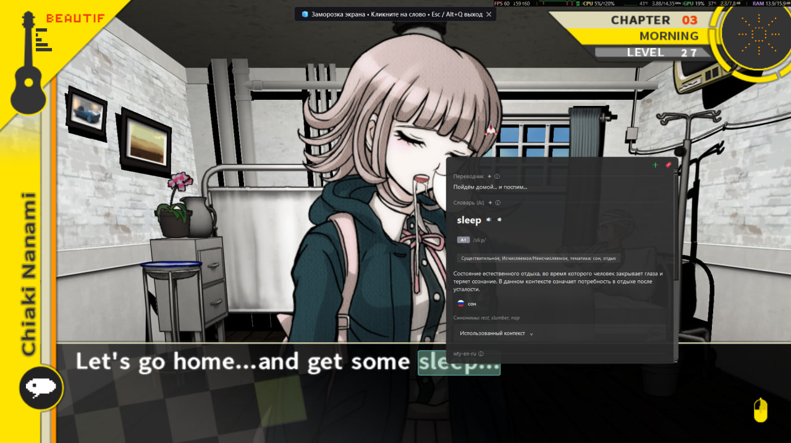

<p align="center">
  
</p>

<h1 align="center">WordSnap</h1>

<p align="center">
  <b>Instant on-screen OCR translator, offline Yomitan dictionary & personal vocabulary trainer.</b><br>
  Designed for language learners, gamers, and avid readers on Windows.
</p>

<p align="center">
  <a href="README.md"><b>English</b></a> • <a href="README_RU.md"><b>Русский</b></a>
</p>

<p align="center">
  
</p>

---

**WordSnap** allows you to point at any word or phrase on your screen — in 3D games, visual novels, videos, PDFs, manga, browsers, or desktop apps — and instantly receive an **OCR-recognized translation**, rich **offline Yomitan dictionary definitions**, and **AI-powered contextual analysis** in an animated, non-intrusive popup right next to your cursor.

Every word you discover can be saved to your **personal vocabulary list** with the original screenshot, sentence context, CEFR level, and tags, or synchronized directly to **Anki** with a single click.

---

## Key Features

### 🔍 Instant On-Screen Lookup
- **Global Hotkey & Mouse Buttons**: Look up words using configurable shortcuts (default: `Alt+Q`, or mouse middle button / side buttons X1 & X2).
- **Windows Native OCR**: Lightning-fast, accurate text recognition without installing third-party OCR software (Tesseract is also supported as an alternative).
- **Adaptive Floating Popup**: Smoothly bounces in next to the word, adjusts position so it never covers the text, and adapts to dark/light screen backgrounds.

### 🎮 Built for Games: Freeze Screen Mode
*Have you ever played an FPS, 3D RPG, or controller-based game where the mouse cursor is invisible or locked to camera rotation?*
- **Freeze Screen Mode ("Заморозка экрана")**: Press your hotkey to freeze the screen pixel-perfect and unlock the Windows mouse cursor (`ClipCursor` release).
- **Interactive Word Hovering**: All detected text on the frozen screen is highlighted on hover with a pointing cursor. Simply click any word to open the translation popup!
- **Auto-Pause Games**: Automatically pauses the game process (`NtSuspendProcess`) during lookup so you never miss dialogues in cutscenes.
- **Quick Dismiss**: Press `Esc`, `Alt+Q`, or click `✕` to immediately unfreeze and resume playing.

<details>
  <summary>🎮 <b>Click to expand / collapse Freeze Screen Mode screenshot</b></summary>
  <br>
  <p align="center">
    <a href="assets/freeze_mode.jpg">
      
    </a>
  </p>
</details>

### 📚 Full Yomitan (.zip) Offline Dictionaries
- **100% Offline Lookups**: Import any standard Yomitan/Yomichan dictionary in `.zip` format (e.g. `wty-en-ru.zip`, JMdict, monolingual English/Japanese dictionaries).
- **Morphological De-inflection**: Automatically recognizes base lemma forms (e.g., looking up `greater` correctly finds `great`, handles verb tenses and plurals).
- **Structured Yomitan Cards**: Styled presentation with phonetic transcriptions, grammar badges, frequency tags, and clear definitions.

### 🤖 Dual AI Sources (Groq & Google Gemini)
- **Contextual Sentence Translation**: Fast neural machine translation of the whole sentence containing the word, factoring in the active game/app lore.
- **Looktionary AI Card**: Comprehensive dictionary entry with CEFR language level (A1–C2), parts of speech, synonyms, definitions, and translations.
- **Ultra-Fast & Resilient**: Supports **Groq** (<1 second response time) and **Google Gemini** (Gemini 2.5 Flash / 2.0 Flash) with automatic multi-model failover.

### 🗃️ 1-Click Anki Integration
- **Direct AnkiConnect Sync**: Connects directly to local Anki (port 8765) without manual file exports.
- **Interactive Setup Wizard**: Select target deck, card note type, and visually map fields (`Word`, `Translation`, `Context`, `Screenshot`, `Audio`, `Definition`).
- **One-Click Add**: Click the green `+` icon in the popup to instantly create a study card with an attached cropped screenshot. Duplicate detection lets you know if a word is already in your deck.

### 📖 Personal Vocabulary Trainer ("Words" Tab)
- **Rich Word Cards**: Browse your saved words with cropped screenshots of the scene, timestamp, source game/app name, and tags.
- **Text-to-Speech (TTS)**: Native audio pronunciation for saved words.
- **Filters & Search**: Filter by language, source application, CEFR level, favorites (★), and custom `#tags`.
- **Export Options**: Export vocabulary to CSV, JSON, or Anki TSV decks.

---

## Keyboard Shortcuts

### Words Page Navigation
| Shortcut | Action |
|---|---|
| `Ctrl+F` | Focus search bar |
| `Space` | Speak selected word (TTS) |
| `Delete` | Delete selected word |
| `Ctrl+D` | Toggle favorite (★) |
| `←` / `→` | Previous / Next word card |

---

## Installation & Downloads

Pre-built binaries for Windows 10/11 are available in the **[Releases](../../releases)** tab:

1. **Installer (`WordSnap-1.0.0-Setup.exe`)**:
   Standard Windows setup wizard with Start Menu shortcut, desktop icon, and uninstaller.
2. **Portable Version (`WordSnap-1.0.0-Portable.zip`)**:
   Self-contained zero-installation version. Extract anywhere (e.g. USB drive or custom folder) and launch `WordSnap.exe`.

---

## Running from Source

### Prerequisites
- Windows 10 or Windows 11 (requires native Windows OCR).
- Python 3.11+.

### Setup
```bash
# Clone the repository
git clone https://github.com/Wefdzen/WordSnap.git
cd WordSnap

# Install dependencies
pip install -r requirements.txt

# Run WordSnap
python main.py
```

On first launch, the interactive **Onboarding Wizard** will guide you through setting up your language, theme, hotkey, and optional AI keys.

---

## Building from Source

To create both the Portable ZIP and Setup Installer executable:

```bash
# Compile standalone distribution, portable ZIP, and installer
python build_dist.py
```
Outputs are generated in the `release/` directory:
- `release/WordSnap-1.0.0-Setup.exe`
- `release/WordSnap-1.0.0-Portable.zip`

*(Note: Building the installer requires [Inno Setup 6](https://jrsoftware.org/isinfo.php). If Inno Setup is not found, the portable build is still completed.)*

---

## Configuration

In the **Settings** tab, you can customize:
- **Theme**: Dark, Light, or follow Windows system theme.
- **Language**: English or Russian.
- **Hotkeys**: Keyboard combination and mouse triggers (middle button / side buttons).
- **OCR Engine**: Windows OCR or Tesseract OCR, along with target recognition language.
- **Game Interactions**:
  - *Freeze screen* (recommended for 3D shooters and games without a visible cursor).
  - *Auto-pause games* (suspends game process during popup lookup).
  - *Stretch to fullscreen* (for windowed games).
- **AI Providers**: Enter your free [Groq API Key](https://console.groq.com/keys) or [Gemini API Key](https://aistudio.google.com/app/apikey).
- **AnkiConnect**: Configure deck name, note type, and field mappings.

---

## License

**PolyForm Noncommercial License 1.0.0**

You are free to use, copy, modify, and share this project for non-commercial purposes (personal study, gaming, research). Commercial use is not permitted. See [LICENSE](LICENSE) for details.
