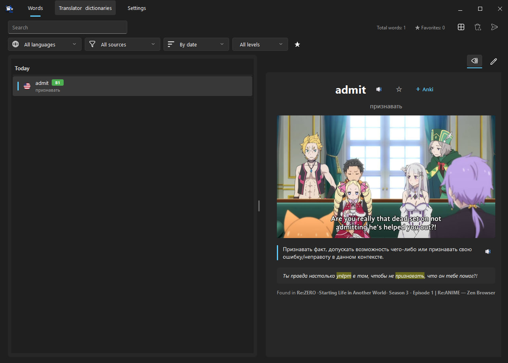

<p align="center">
  
</p>

<h1 align="center">WordSnap v1.3.0</h1>

<p align="center">
  <b>Экранный OCR-переводчик, офлайн-словарь Yomitan и карточки Anki для Windows.</b><br>
  Мгновенный перевод слов в играх, видео, книгах и любых приложениях по наведению курсора.
</p>

<p align="center">
  <a href="README.md"><b>English</b></a> • <a href="README_RU.md"><b>Русский</b></a> • <a href="https://www.donationalerts.com/r/wefdzen"><b>Поддержать ❤️</b></a>
</p>

<p align="center">
  
</p>

---

## ⚡ Главные возможности

- **Экранный перевод по клику / хоткею** — быстрый встроенный Windows OCR (или Tesseract). Нажмите `Alt+Q` или кнопку мыши, и всплывающее окно перевода появится прямо у слова.
- **Режим «Заморозка экрана» для игр** — идеален для 3D/FPS, шутеров и игр с геймпада: мгновенно фиксирует кадр, разблокирует курсор мыши, интерактивно подсвечивает слова при наведении и ставит процесс игры на паузу (auto-pause).
- **Офлайн-словари Yomitan (.zip)** — 100% работа без интернета, деинфлексия (поиск базовых форм слов), транскрипции, теги частотности и удобный менеджер словарей прямо в приложении.
- **ИИ-перевод (Groq и Google Gemini)** — контекстный перевод предложений с учётом сленга игры и карточка слова Looktionary (уровень CEFR A1–C2, синонимы, грамматика).
- **Интеграция с Anki в 1 клик** — прямое подключение к AnkiConnect: добавление карточек со скриншотом сцены, контекстом, озвучкой и проверкой дубликатов.
- **Личный словарь («Слова»)** — карточки со скриншотами игровой сцены, озвучка TTS, фильтры по датам/уровням/тегам и экспорт в CSV, JSON, Anki TSV.
- **Fluent UI под Windows 10/11** — тёмная и светлая темы, нативные скругления окон, сворачивание в системный трей без сдвига координат.

---

## 📥 Скачать (Windows 10 / 11)

Готовые сборки доступны в разделе **[Releases](../../releases)**:

| Версия | Описание | Файл |
|---|---|---|
| **Установщик (Setup)** | Стандартный мастер установки с ярлыками и деинсталлятором | [`WordSnap-1.3.0-Setup.exe`](../../releases) |
| **Портативная (Portable)** | Не требует установки, работает из любой папки или с флешки | [`WordSnap-1.3.0-Portable.zip`](../../releases) |

---

## ⌨️ Горячие клавиши по умолчанию

| Сочетание | Область | Действие |
|---|---|---|
| `Alt+Q` | Глобально | Распознать текст под курсором / открыть переводчик |
| `Esc` / `✕` | Оверлей / попап | Закрыть перевод / снять заморозку экрана |
| `Ctrl+F` | Вкладка «Слова» | Фокус на строке поиска |
| `Пробел` | Вкладка «Слова» | Озвучить выбранное слово (TTS) |
| `Ctrl+D` | Вкладка «Слова» | Добавить / убрать из избранного (★) |
| `Delete` | Вкладка «Слова» | Удалить слово |
| `↑` / `↓` | Вкладка «Слова» | Предыдущее / следующее слово |

---

## 🚀 Запуск из исходного кода

### Требования
- Windows 10 / 11
- Python 3.11+

```bash
git clone https://github.com/Wefdzen/WordSnap.git
cd WordSnap
pip install -r requirements.txt
python main.py
```

### Сборка дистрибутива:
```bash
python build_dist.py
```
Готовые файлы (`.zip` и `.exe`) сохраняются в папку `release/`.

---

## 💖 Поддержка проекта

Если WordSnap помогает вам изучать языки и проходить игры в оригинале:
👉 **[DonationAlerts](https://www.donationalerts.com/r/wefdzen)**

---

## Лицензия

[PolyForm Noncommercial License 1.0.0](LICENSE) — бесплатно для личного некоммерческого использования.
